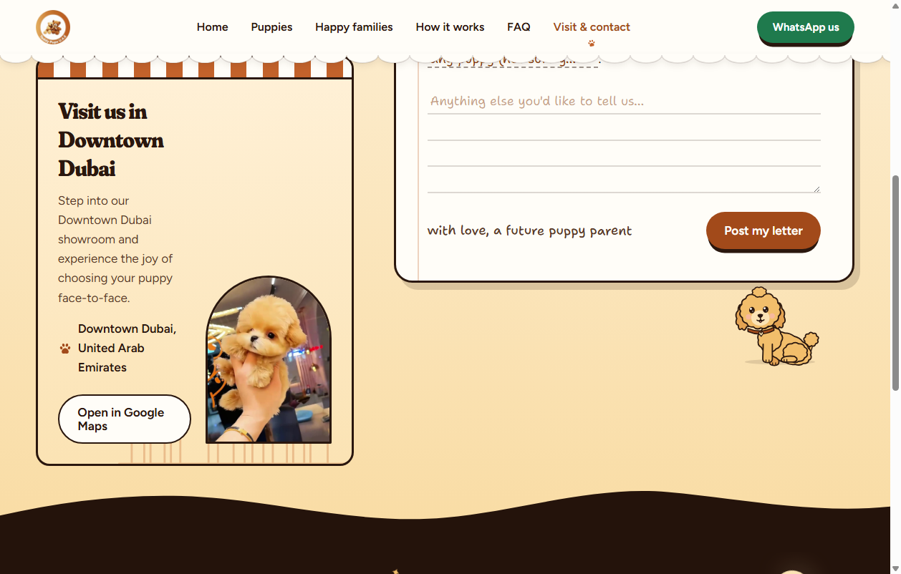
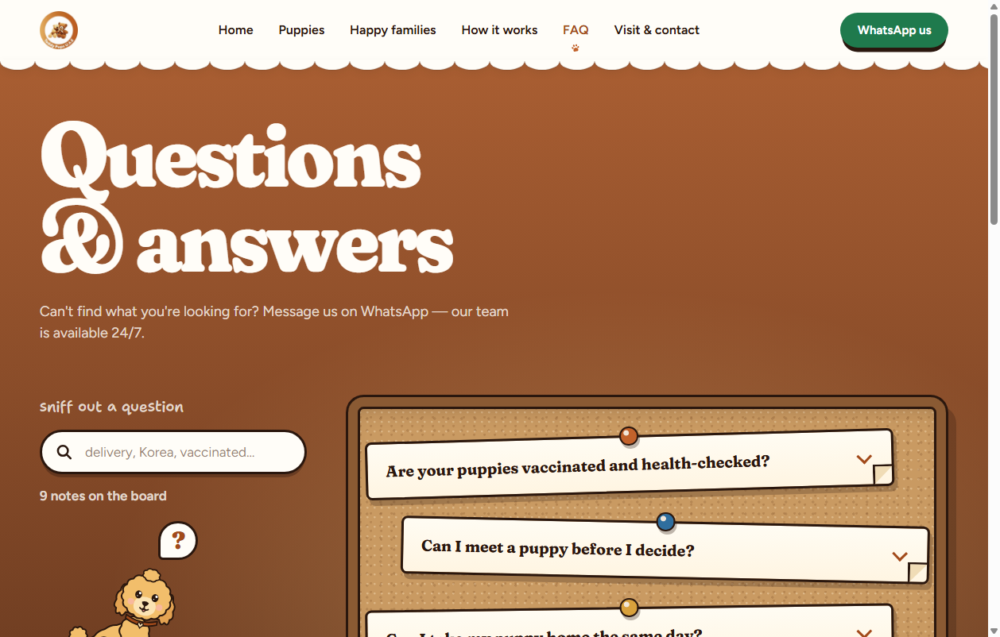
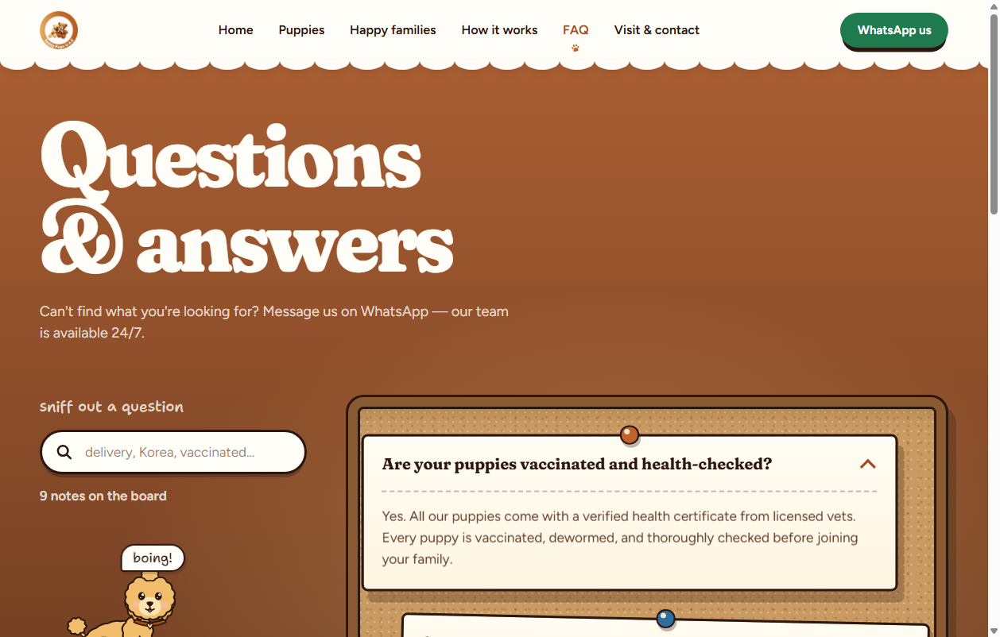
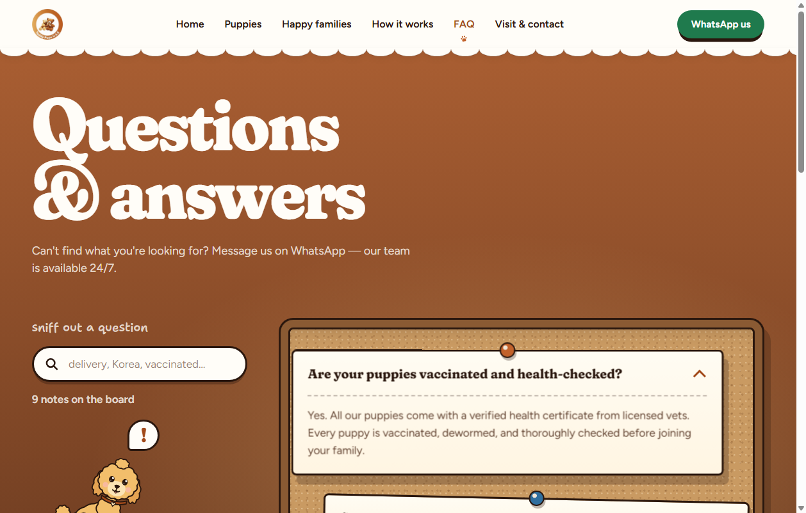

# TeddyPups

A React + TypeScript recreation of the TeddyPups puppy concierge website, built with Vite. The project aims to reproduce the original site's visual design, page structure, puppy listings, puppy detail pages, illustrated mascots, and scroll-driven animations as closely as can be verified.

## Overview

TeddyPups is an ethical luxury puppy concierge based in Dubai that connects families with vetted Korean and European puppies. This repository is a **recreation project, not a redesign**: the live website is the reference for appearance and behaviour.

- **Reference website:** https://puppy.instabizweb.com/
- **Repository:** https://github.com/tecnicoviola/TeddyPups

## Features

The features below describe the intended scope of the recreation. Items are grouped by area; see [Future Improvements](#future-improvements) for known outstanding work.

<!-- TODO: confirm each item against src/ and mark implemented vs. in progress. The src/ folder was not inspectable when this README was drafted. -->

**Homepage**
- Hero section with puppy illustration
- Puppy discovery and imported-puppy content
- Ways to meet a puppy
- Puppy journey and delivery explanation, with a scroll-linked airplane
- Puppy passport content
- Happy Families section
- Final door / welcome-home scene and footer

**Available Puppies**
- Filter panel: Where (Everywhere, Imported, Korean Teacup), Breed (Maltipoo, Pomeranian, Poodle, Cavapoo, Shih Tzu), Gender (Boys, Girls)
- Live result count and clear/reset
- Puppy cards with individual imagery
- "Already gone home" section

**Puppy detail pages**
- Puppy-specific information, WhatsApp and Send Enquiry actions
- Image and video gallery with previous/next controls, counter, thumbnails, and video playback
- "What comes with this puppy", health and care information, "The way home" steps
- Enquiry form

**Other pages and shared elements**
- Happy Families, FAQ, and Contact pages
- Illustrated dog mascots with speech bubbles and expressions
- Custom paw-shaped cursor
- Shared header, footer, and navigation

## Screenshots

No curated screenshots have been added yet. The repository root currently contains these reference captures of the mascot on the Contact and FAQ pages:

| Contact mascot | FAQ |
| --- | --- |
|  |  |
|  |  |

<!-- Add homepage, Available Puppies, and puppy detail screenshots (e.g. under docs/) once captured. -->

## Tech Stack

Verified from `package.json` and `vite.config.ts`:

| Area | Technology |
| --- | --- |
| UI library | React 19 |
| Language | TypeScript 5.7 |
| Build tool / dev server | Vite 6 with `@vitejs/plugin-react` |
| Routing | React Router (`react-router-dom` 7) |
| Icons | `lucide-react` |
| Class utilities | `clsx`, `tailwind-merge` |

The project is an ES module package (`"type": "module"`) and is marked `private`. No backend, test framework, or linter is listed in `package.json`.

<!-- TODO: confirm how styling is implemented (index.html uses utility-style classes such as bg-milk / text-cocoa, but no tailwindcss dependency appears in package.json). -->

## Project Structure

Top level of the repository:

```
TeddyPups/
├── docs/                 # Documentation
├── public/               # Static assets served as-is (brand, fonts, images)
├── scripts/              # Project scripts
├── src/                  # Application source (entry: src/main.tsx)
├── index.html            # Vite HTML entry
├── package.json
├── package-lock.json
├── tsconfig.json
├── vite.config.ts
├── contact_mascot_tail_wagging.png   # Reference captures
├── faq_initial_q.png
├── faq_mascot_speaking.png
└── faq_note_opened_exclamation.png
```

- `index.html` mounts the app at `#root` from `/src/main.tsx` and preloads `/brand/logo.png` and web fonts from `/fonts/`.
- The `@` import alias resolves to `./src`.

<!-- TODO: expand src/ (routes, pages, components, data), and describe docs/ and scripts/ contents. -->

## Getting Started

### Prerequisites

- Node.js 18 or newer (required by Vite 6)
- npm (a `package-lock.json` is committed)

### Installation

```bash
git clone https://github.com/tecnicoviola/TeddyPups.git
cd TeddyPups
npm install
```

### Run the development server

```bash
npm run dev
```

The dev server listens on port **3000** and on all network interfaces (`host: true`), so it is reachable at http://localhost:3000 and from other devices on your network.

## Environment Variables

No environment variables or `.env.example` file were found at the repository root, and none are referenced in `package.json` or `vite.config.ts`. No `.env` file is needed to run the project as configured.

<!-- TODO: if src/ reads import.meta.env.* values, list their names here. Never commit real secrets. -->

## Available Scripts

| Command | Description |
| --- | --- |
| `npm run dev` | Start the Vite development server on port 3000 |
| `npm run build` | Create a production build with `vite build` |
| `npm run preview` | Serve the production build locally with `vite preview` |

There are no `test` or `lint` scripts defined.

## Application Pages and Architecture

The app is a single-page application: `index.html` loads `src/main.tsx`, and client-side routing is provided by `react-router-dom`. The intended route set is Home, Available Puppies, individual puppy detail pages, Happy Families, FAQ, and Contact.

<!-- TODO: replace with the actual route table and key components/data modules from src/. -->

### Development image proxy

`vite.config.ts` includes a dev-server-only plugin (`next-image-proxy`). Requests to `/_next/image?url=...` are answered by reading the referenced file from `public/` (falling back to `public/images/<filename>`) and streaming it with the correct image content type. This lets paths copied from the original Next.js site resolve locally. It does not apply to the production build.

## Design and Animation

The recreation relies on illustrated mascots and scroll-linked effects rather than static images. Targeted behaviour includes:

- Dog mascot walking, tail movement, changing expressions, and contextual speech bubbles
- Scroll-linked airplane in the delivery section
- Door animation synchronised with the dog's approach on the homepage
- Mascot reactions on FAQ, Contact, and Happy Families
- Paw-shaped custom cursor with a transparent background

<!-- TODO: document how these are implemented (components, scroll-progress hooks) once src/ is reviewed. -->

## Testing and Build

There is no automated test suite or linter configured. To verify changes locally:

```bash
npm run build      # confirm the production build succeeds
npm run preview    # serve the build and check it in the browser
```

Then manually check affected routes, filters, forms, and gallery controls; watch the browser console and terminal for errors; test scroll animations in both directions at slow and fast speeds; and compare against the reference site at matching viewport sizes on desktop and mobile.

## Development Notes

- The dev server's file watcher ignores `**/.chrome*/**`, `**/reference/**`, `**/*.png`, `**/*.jpg`, and `**/*.webp`. After adding or replacing images, you may need to reload the page manually.
- `npm run build` runs `vite build` only and does not type-check.
- Use the correct individual images and videos for each puppy; do not substitute placeholders.
- Preserve spam-prevention on the enquiry form, and do not expose honeypot fields as normal inputs.
- Do not claim exact parity with the original for details that cannot be inspected.

## Future Improvements

Known outstanding corrections, as recorded in the project summary:

1. **Homepage speech bubbles:** the dog's `hm?` bubble appears too often. Replace it with a contextual, scroll-synchronised message timeline matching the original, with no overlapping bubbles.
2. **Dog in the bucket:** the dog sits too low. Raise its face and paws so the head clears the rim, with the bucket rim layered in front.

Other items:

- Add a test setup and a lint configuration
- Add curated screenshots
- Verify responsive layouts on desktop and mobile
- Complete `.env.example` documentation if environment variables are introduced

## Acknowledgements

Visual design, content, and interaction patterns are based on the original TeddyPups website: https://puppy.instabizweb.com/. This repository is an independent recreation for learning and reference.
